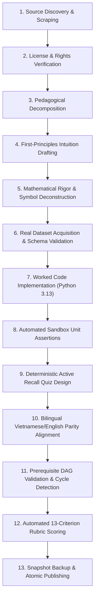

# CHINAI AI Learning OS — Content Ingestion Pipeline & Governance CLI

## 1. The 13-Stage Content Pipeline Architecture

Every learning asset in CHINAI AI Learning OS passes through a 13-stage automated ingestion pipeline:



---

## 2. Content Governance CLI Commands (`app.cli_content`)

The backend provides a production CLI for CI/CD pipelines and content maintainers:

### 2.1 `content:validate`
Audits bilingual curriculum parity, prerequisite DAG acyclicity, missing dependencies, and 13-criterion rubric scoring across all 15 tracks.
```bash
python -m app.cli_content content:validate
```

### 2.2 `content:report`
Generates a comprehensive summary report of all 15 tracks, dataset associations, and rubric statistics.
```bash
python -m app.cli_content content:report
```

### 2.3 `resources:check`
Audits all 21 verified OER resources to ensure HTTPS URL reachability, SPDX license validity, and access model compliance.
```bash
python -m app.cli_content resources:check
```

### 2.4 `content:import --dry-run`
Simulates content ingestion and tests quality gates without writing to disk or modifying the active curriculum.
```bash
python -m app.cli_content content:import --dry-run
```

### 2.5 `content:import`
Executes safe ingestion, creating a versioned snapshot backup in `backend/data/backups/` and updating `published_manifest.json`.
```bash
python -m app.cli_content content:import
```

### 2.6 `content:publish`
Publishes staged curriculum content into the production manifest after all automated gates pass.
```bash
python -m app.cli_content content:publish
```

### 2.7 `content:rollback`
Safely restores the previous versioned curriculum snapshot from `backend/data/backups/` while preserving student learner progress (`UserProgress`).
```bash
python -m app.cli_content content:rollback
```

---

## 3. REST API Endpoints for Content Pipeline

The CLI commands are also mirrored as authenticated administrative API endpoints:
- `GET /api/learn/pipeline/report`
- `POST /api/learn/pipeline/import` (supports `?dry_run=true`)
- `POST /api/learn/pipeline/rollback`
- `GET /api/learn/governance/audit?lang=vi`
- `GET /api/learn/oer/resources`
