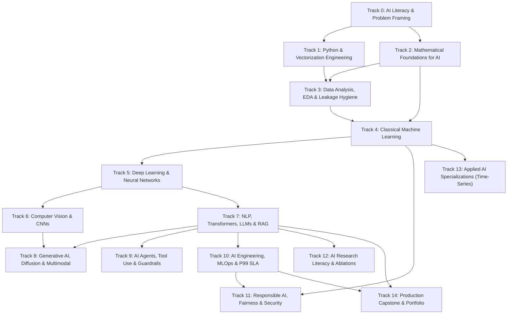

# CHINAI AI Learning OS — 15-Track Curriculum Map & Prerequisite Graph (`Track 0` → `Track 14`)

## 1. Curriculum Architecture Overview

CHINAI AI Learning OS implements a **15-Track Prerequisite-First Directed Acyclic Graph (DAG)** in both Vietnamese (`vi`) and English (`en`), covering 4 progressive competency tiers (**Beginner → Intermediate → Advanced → Research/Expert**) and 5 specialization branches:

- `CORE_FOUNDATION` (Tracks 0–4): Mandatory core for all learners.
- `APPLIED_ENGINEER` (Tracks 5–9, 11): Deep Learning, Computer Vision, NLP/LLM/RAG, Multimodal Diffusion, AI Agents, and Responsible AI.
- `SYSTEMS_MLOPS` (Track 10): AI Systems Engineering, P99 Latency SLA, Drift Detection, and Serving.
- `RESEARCH_SPECIALIZATION` (Tracks 12–13): Scientific Paper Reading, Ablation Studies, and Time-Series/Anomaly Detection.
- `CAPSTONE_PORTFOLIO` (Track 14): End-to-End Production Capstone & Multi-Metric Gate-Guarded Evaluation.

---

## 2. Complete 15-Track Matrix (`Track 0` → `Track 14`)

| Track # | Track ID | Title (EN / VI) | Level | Branch | Prerequisites | Primary Verified Dataset |
| :--- | :--- | :--- | :--- | :--- | :--- | :--- |
| **0** | `track-foundations` | AI Literacy, Thinking & Problem Framing / Nhập môn Tư duy AI | Beginner | `CORE_FOUNDATION` | `[]` | UCI Spambase & Rule- vs ML Triage |
| **1** | `track-python` | Python & Vectorization for AI / Lập trình Python & Vector hóa | Beginner | `CORE_FOUNDATION` | `["track-foundations"]` | Hardware Vectorization Benchmark |
| **2** | `track-math` | Mathematical Foundations for AI / Toán học Nền tảng cho AI | Beginner | `CORE_FOUNDATION` | `["track-foundations"]` | UCI Iris / Gradient & Dot-Product Tensors |
| **3** | `track-data-science` | Data Analysis, EDA & Leakage Hygiene / Phân tích Dữ liệu & Chống Rò rỉ | Beginner | `CORE_FOUNDATION` | `["track-python", "track-math"]` | OpenML Credit-G / Leakage Audit |
| **4** | `track-ml` | Classical Machine Learning / Học máy Cổ điển (Scikit-Learn) | Intermediate | `CORE_FOUNDATION` | `["track-math", "track-data-science"]` | UCI Breast Cancer Wisconsin (Diagnostic) |
| **5** | `track-dl` | Deep Learning & Neural Networks / Học sâu & Mạng Nơ-ron | Advanced | `APPLIED_ENGINEER` | `["track-ml"]` | MNIST / Fashion-MNIST Gradient Flow |
| **6** | `track-computer-vision` | Computer Vision & Spatial Convolutions / Thị giác Máy tính & Tích chập | Advanced | `APPLIED_ENGINEER` | `["track-dl"]` | Fashion-MNIST Spatial Edge Kernel |
| **7** | `track-llm` | NLP, Transformers, LLMs & RAG / Xử lý Ngôn ngữ Tự nhiên, LLM & RAG | Advanced | `APPLIED_ENGINEER` | `["track-dl"]` | MS MARCO & MTEB Retrieval Benchmark |
| **8** | `track-generative-multimodal` | Generative AI, Diffusion & Multimodal / AI Tạo sinh, Khuếch tán & Đa phương thức | Advanced | `APPLIED_ENGINEER` | `["track-computer-vision", "track-llm"]` | MS-COCO Multimodal CLIP & DDPM Schedule |
| **9** | `track-ai-agents` | AI Agents, Tool Use & Guardrails / Tác tử AI (ReAct), Công cụ & Hàng rào An toàn | Advanced | `APPLIED_ENGINEER` | `["track-llm"]` | GAIA & SWE-bench Agentic Tool Reliability |
| **10** | `track-mlops` | AI Engineering, MLOps & Production Serving / Kỹ thuật Hệ thống AI & Vận hành MLOps | Advanced | `SYSTEMS_MLOPS` | `["track-ml", "track-llm"]` | MLPerf Inference P99 Latency Telemetry |
| **11** | `track-responsible-ai-security` | Responsible AI, Fairness & Governance / AI Có trách nhiệm, Công bằng & Bản quyền | Advanced | `APPLIED_ENGINEER` | `["track-ml", "track-mlops"]` | UCI German Credit (Statlog) Fairness Audit |
| **12** | `track-ai-research` | AI Research Literacy & Ablation Studies / Phương pháp Đọc Bài báo & Thực nghiệm Khoa học | Research/Expert | `RESEARCH_SPECIALIZATION` | `["track-dl", "track-llm"]` | PapersWithCode Ablation Study Benchmark |
| **13** | `track-applied-specializations` | Applied AI Specializations (Time-Series) / Chuyên ngành AI Ứng dụng (Chuỗi thời gian) | Advanced | `RESEARCH_SPECIALIZATION` | `["track-ml", "track-dl"]` | Numenta Anomaly Benchmark (NAB) Telemetry |
| **14** | `track-capstone` | Capstone Projects & Production Portfolio / Đồ án Thực chiến & Hồ sơ Năng lực | Advanced | `CAPSTONE_PORTFOLIO` | `["track-llm", "track-mlops"]` | MLCommons Multi-Metric Release Benchmark |

---

## 3. Role-Based Learning Pathways

1. **AI Explorer / Beginner (`persona = beginner`)**:
   - Focuses on `Track 0` → `Track 1` → `Track 2` → `Track 3` → `Track 4`.
   - Builds intuition first, decodes every mathematical symbol with sample numbers, and masters Python vectorization and leakage-free data preparation.
2. **Applied AI / ML Engineer (`persona = engineer`)**:
   - Completes or tests out of `Tracks 0–4`, then advances through `Track 5` (Deep Learning), `Track 6` (Vision), `Track 7` (LLM/RAG), `Track 8` (Multimodal), `Track 9` (AI Agents), `Track 10` (MLOps), `Track 11` (Responsible AI), and `Track 14` (Capstone).
3. **AI Research & Domain Specialist**:
   - Adds `Track 12` (Scientific Paper Reading, Reproducibility & Ablation Methodology) and `Track 13` (Time-Series EWMA & Streaming Anomaly Detection).
