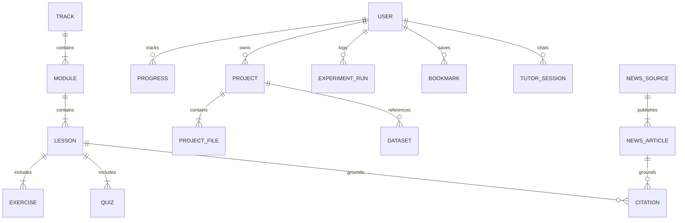

# Information Architecture — AI Learning OS

**Version**: 1.0.0  
**Status**: Active  
**Author**: Principal Product Architect

---

## 1. Unified Navigation Model

AI Learning OS provides a shared user identity and data model spanning two complementary modes:
- **Learn Mode**: Optimized for step-by-step educational mastery, intuitive explanations, visual interactive models, and low technical friction.
- **Engineer Mode**: Optimized for high-density development, multi-file code editing, execution debugging, datasets analysis, and model experimentation.

### Global App Bar (Header)
```
[ AI Learning OS Logo ]  [ Search ⌘K ]  [ Mode Toggle: Learn / Engineer ]  [ Notifications ]  [ Theme Toggle ]  [ User Profile ]
```

### Primary Navigation Areas
| Area | Primary Mode | Description |
| :--- | :--- | :--- |
| **Home / Overview** | Shared | Daily progress summary, recommended next lesson, recent workspace projects, curated AI news alerts. |
| **Learn** | Learn Mode | Complete syllabus navigation across 7 curriculum tracks, module maps, interactive lessons, and quizzes. |
| **Diagnostic Placement**| Learn Mode | 10-question placement assessment recommending learner entry points across foundations, ML, and LLMs. |
| **Engineer Workspace**| Engineer Mode | Multi-panel IDE with Monaco editor, real file tree, terminal output, AI assistant, and runner. |
| **Datasets** | Engineer Mode | Upload, inspect, sample, and compute summary statistics on CSV/JSON datasets. |
| **Experiments** | Engineer Mode | Hyperparameter tracking, training loss/accuracy comparison, run metrics, artifact history. |
| **AI News Radar** | Shared | Live-ingested research and model announcements from arXiv, OpenAI, Google DeepMind, and Hugging Face. |
| **AI Tutor** | Shared | Grounded conversational assistant with citations linked directly to internal lessons and news records. |
| **Settings** | Shared | Themes, accessibility preferences, safe execution timeouts, telemetry consent, and data export. |

---

## 2. Shared Domain Model Relationships



---

## 3. Data Governance & User Data Ownership
- Users can export all learner progress, assessment history, workspace code files, and conversation transcripts as a single JSON/ZIP package.
- All code files created in the workspace remain local to the user session / persistent directory; untrusted code is never sent to third-party models without explicit user intent.
