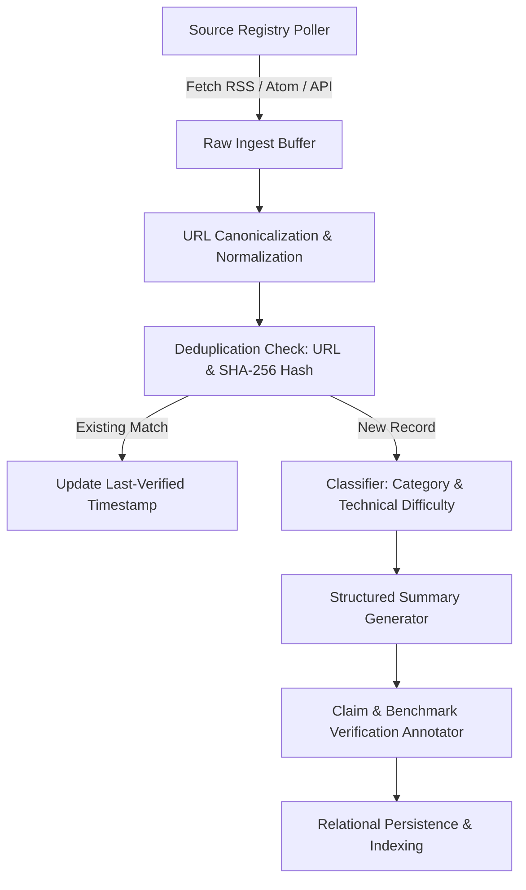

# AI News Radar Architecture & Data Pipeline — AI Learning OS

**Version**: 1.0.0  
**Status**: Active  
**Author**: Information Retrieval Engineer & AI Research Engineer

---

## 1. Mission & Pipeline Principles
AI News Radar provides continuous, source-grounded intelligence for AI practitioners.
- **Source Integrity**: Only permitted, authoritative sources are ingested (official research blogs, arXiv AI/ML categories, model repositories).
- **Zero Fabrication**: Publication timestamps, authors, benchmarks, and quotations are never invented. When publication hours/minutes are absent, only the verified date is preserved.
- **Idempotency & Deduplication**: Pipeline executions are strictly idempotent. Articles are identified by canonicalized URLs and SHA-256 body hashes.

---

## 2. Ingestion Pipeline Stages

---

## 3. Registered Source Connectors

| Source ID | Name | Connector Type | Base URL | Trust Tier | Polling Interval |
| :--- | :--- | :--- | :--- | :--- | :--- |
| `src-arxiv-cs-ai` | arXiv Artificial Intelligence | RSS Feed | `https://rss.arxiv.org/rss/cs.AI` | Tier 1 (Peer/Preprint) | 6 hours |
| `src-arxiv-cs-lg` | arXiv Machine Learning | RSS Feed | `https://rss.arxiv.org/rss/cs.LG` | Tier 1 (Peer/Preprint) | 6 hours |
| `src-openai-news` | OpenAI Research & Announcements | RSS / Feed | `https://openai.com/news/rss.xml` | Tier 1 (Official Lab) | 4 hours |
| `src-google-deepmind`| Google DeepMind Research | RSS Feed | `https://deepmind.google/blog/rss.xml` | Tier 1 (Official Lab) | 4 hours |
| `src-huggingface` | Hugging Face Blog | RSS Feed | `https://huggingface.co/blog/feed.xml` | Tier 1 (Ecosystem Hub) | 4 hours |
| `src-mit-tech-review`| MIT Tech Review AI | RSS Feed | `https://www.technologyreview.com/topic/artificial-intelligence/feed` | Tier 2 (Tech Journalism)| 12 hours |

---

## 4. Structured Record Schema & Summary Contract

Every news record conforms to the following schema:
- `id`: Stable internal UUID (`news-xxx`).
- `canonical_url`: Normalized URL (trailing slashes stripped, tracking UTM parameters removed).
- `title`: Original source title.
- `source`: Source provider name.
- `author`: Original author(s) or lab name.
- `published_at`: ISO 8601 publication timestamp from source metadata.
- `category`: `Model Releases` | `Research Breakthroughs` | `LLMs` | `Computer Vision` | `AI Safety & Alignment` | `AI Systems & MLOps` | `Open Source`.
- `difficulty`: `Beginner Friendly` | `Applied Engineering` | `Deep Research`.
- `summary`:
  - **What Happened?**: Concise factual statement.
  - **What is New?**: Distinct delta from prior methods.
  - **Why it Matters?**: Architectural or commercial implication.
  - **Who Should Care?**: Target practitioners.
  - **Confirmed vs Unverified**: Specific benchmark caveats, claims tested vs vendor statements.
  - **Recommended Next Action**: Suggested platform lesson or practical workspace experiment.
- `verification_status`: `VERIFIED` | `VENDOR_CLAIM` | `SPECULATIVE`.
